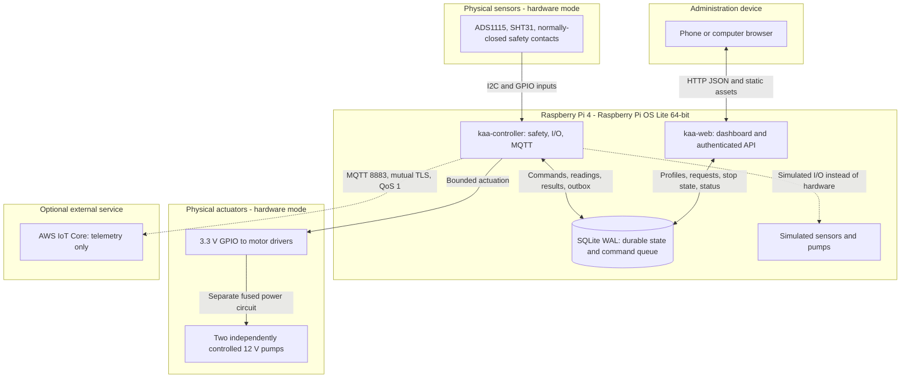

# ka-a

A Python irrigation and monitoring station for Raspberry Pi 4, with independent
care profiles for two junipers and a responsive Spanish administration dashboard.
The controller runs locally; Internet and AWS are optional for plant control.

**Base OS: Raspberry Pi OS Lite 64-bit.** Open the dashboard from a phone or computer
browser; the Pi needs no desktop environment. This project supplies the application,
installer, and systemd services, not a custom Linux distribution.

| Read this for...                           | Entry point                                               |
| ------------------------------------------ | --------------------------------------------------------- |
| Recommended purchases                      | [Hardware shopping list](#hardware-shopping-list)         |
| Software and dependencies                  | [Software and stack](#software-and-stack)                 |
| Services, data flow, and technical diagram | [Architecture](#architecture)                             |
| Local simulation                           | [Quick start](#quick-start)                               |
| Target-device deployment                   | [Raspberry Pi installation](#install-on-the-raspberry-pi) |
| AI-assisted questions or changes           | [LLM entry point](llm/README.md)                          |

## Project scope

The first installation is for two junipers, approximately 10 and 7 years old, on a
sheltered outdoor balcony. Each pot footprint is about 30 x 30 cm and tree + pot
weight about 10-15 kg. The proposed shelf is **80 cm wide x 40 cm usable depth**,
fully inside the balcony. Its supports and concrete anchors are selected and paid
for locally; load capacity must be verified on site.

The balcony has no direct sun. Elevating foliage above the mureta improves sky
exposure but does not establish adequate light. Probe fit, substrate depth, cultivar,
flow, water needs, and possible supplemental lighting remain installation decisions.
See [hardware and placement details](docs/HARDWARE.md).

## Hardware shopping list

This section is **hardware only**. The Raspberry Pi 4 and 3D printer already exist.
The owner's target is **USD 150-300**, excluding the locally fabricated shelf,
installation, software, AWS, shipping, and import charges.

Amazon links are product lookups or reference listings, **not a verified shopping
cart or compatibility guarantee**. Ranges are planning allowances as of 2026-11-09,
not confirmed checkout prices. Select exact models against the
[wiring contract](docs/HARDWARE.md#low-voltage-pin-map-bcm-numbering).

### Irrigation and monitoring

| Qty   | Hardware / Amazon reference                                                                                        | Required interface or condition                                           | Estimated subtotal            |
| ----- | ------------------------------------------------------------------------------------------------------------------ | ------------------------------------------------------------------------- | ----------------------------- |
| 2     | [Protected capacitive probes, reference SEN0308](https://www.amazon.com/s?k=DFRobot+SEN0308)                       | Analog output suitable for a 3.3 V ADC; verify probe fit                  | USD 30-45                     |
| 1     | [ADS1115 I2C ADC](https://www.amazon.com/s?k=ADS1115+ADC+I2C)                                                      | 3.3 V logic; A0/A1; default address `0x48`                                | USD 8-15                      |
| 1     | [Outdoor SHT31, reference SEN0385](https://www.amazon.com/s?k=DFRobot+SEN0385+SHT31)                               | 3.3 V-compatible I2C; default `0x44`; ventilated shield                   | USD 20-30                     |
| 2     | [12 V peristaltic pumps, reference Gikfun AE1207](https://www.amazon.com/dp/B01IUVHB8E)                            | One per pot; measure actual flow                                          | USD 30-40                     |
| 2     | [Motor MOSFET drivers, reference Adafruit 5648](https://www.amazon.com/s?k=Adafruit+5648+MOSFET)                   | Active-high 3.3 V control, flyback protection, physical default-off state | USD 12-22                     |
| 1     | [Regulated 12 V supply, initial reference 3 A](https://www.amazon.com/s?k=12V+3A+power+supply+100-240V)            | Verify motor startup current and local 220-240 V mains input              | USD 12-20                     |
| 1     | [Water-level float](https://www.amazon.com/s?k=water+level+float+switch+normally+closed)                           | Voltage-free contact closed while water level is safe                     | USD 4-8                       |
| 1     | [Leak detector with dry-contact interface](https://www.amazon.com/s?k=water+leak+detector+dry+contact+relay)       | Loop closed only while safe; detector power loss must open it             | USD 15-30                     |
| 1 set | [Silicone tubing, connectors, outlets](https://www.amazon.com/s?k=silicone+tubing+2mm+ID+4mm+OD)                   | Match pump tubing; distribute through open outlets                        | USD 10-18                     |
| 1     | [IP65 enclosure and cable glands](https://www.amazon.com/s?k=IP65+electronics+enclosure+cable+glands)              | Protected location; separate water from electronics                       | USD 15-25                     |
| 1 set | [Wiring, terminals, fuses, pump-power switch](https://www.amazon.com/s?k=DC+wiring+terminal+block+inline+fuse+kit) | Correct ratings and accessible disconnect                                 | USD 12-20                     |
| 1     | Opaque covered reservoir, approximately 5 L                                                                        | Below outlets; verify absence of siphoning                                | USD 10-15                     |
| 2     | [Independent electrical runtime cutoffs](https://www.amazon.com/s?k=12V+timer+relay+maximum+run+time)              | One per pump; non-retriggering cutoff compatible with driver circuit      | Quote after circuit selection |
| 1 set | Drain trays and tube/plant retention                                                                               | Fit actual pots and shelf; source locally or with hardware                | Quote locally                 |

**Indicative subtotal for the twelve priced rows: USD 178-288.** Independent
cutoffs, trays, any signal-conditioning parts, and optional lighting are additional.
A complete unattended installation is not yet confirmed within USD 300.

Before buying:

- The [SEN0308 specification](https://wiki.dfrobot.com/sen0308) lists **175 x 30 mm**
  dimensions and nominal 0-2.9 V output. Tree height is not substrate depth; do not
  force this probe into a shallow pot or roots.
- The real adapter expects **normally-closed, voltage-free safety loops**. A bare
  leak PCB with an unknown 5 V output is not a drop-in replacement. Check behavior
  on unplugged cables and loss of detector power.
- Verify driver capacity, supply current, and cutoff behavior with the selected
  motors. Pumps use a different supply from the Pi's USB-C supply.
- Add an appropriate 5 V/3 A USB-C supply and microSD if the existing Pi lacks them;
  those accessories are not included in this subtotal.

For manufacturer price context, [Gikfun lists the pump at USD 16.88](https://gikfun.com/products/gikfun-12v-dc-dosing-pump-peristaltic-dosing-head-with-connector-for-arduino-aquarium-lab-analytic-diy)
and [DFRobot lists the outdoor SHT31 at USD 19.90](https://www.dfrobot.com/category-64.html/).
These are supplier references, not Amazon quotes.

### Conditional additions

| Item                                                                                                      | Selection condition                                                            | Software status                                   |
| --------------------------------------------------------------------------------------------------------- | ------------------------------------------------------------------------------ | ------------------------------------------------- |
| [Dimmable full-spectrum grow LED](https://www.amazon.com/s?k=dimmable+full+spectrum+grow+light+100W+220V) | Measure foliage-level light; verify coverage, voltage, and balcony suitability | Mains lamp control is not implemented             |
| Compatible lighting timer/controller                                                                      | Select with the lamp, separately from GPIO                                     | Separate commissioning required                   |
| Smaller probes or load-cell/HX711 assemblies                                                              | If protected probes do not fit or readings are unstable                        | Different sensors require driver/contract changes |

No UV lamp or automated foliar-misting circuit is part of the initial purchase.
3D printing can supply tube clips, sensor holders, and a ventilated shield.
Structural supports and watertight containment need appropriate materials and
verification. Wiring and commissioning are in [docs/HARDWARE.md](docs/HARDWARE.md).

## Software and stack

| Layer          | Implementation                                       | Role                                                                |
| -------------- | ---------------------------------------------------- | ------------------------------------------------------------------- |
| OS             | Raspberry Pi OS Lite 64-bit                          | Headless Raspberry Pi 4 host                                        |
| Language       | Python 3.11+                                         | API, persistence, control, drivers, CLI, optional MQTT              |
| API            | FastAPI, Pydantic, Uvicorn                           | Authenticated JSON endpoints and strict validation                  |
| Dashboard      | Static HTML, CSS, JavaScript, SVG                    | Spanish responsive UI served by FastAPI; no frontend build          |
| Storage        | Python `sqlite3`, SQLite WAL                         | Profiles, readings, commands, reservations, audit, sessions, outbox |
| Configuration  | PyYAML and validated settings                        | Local paths, GPIO mapping, bounds, certificate paths                |
| Device I/O     | GPIO Zero/lgpio, Adafruit Blinka, ADS1x15 v3, SHT31D | GPIO outputs/safety inputs and I2C readings                         |
| Optional cloud | Paho MQTT, AWS IoT Core                              | Outbound telemetry with mutual TLS and QoS 1                        |
| Services       | systemd                                              | Separate web and actuator processes, restricted permissions         |
| Packaging      | Hatchling, `pyproject.toml`, `constraints.txt`       | Python package, CLI, validated dependency constraints               |
| Checks         | pytest, HTTPX, Ruff, Python Playwright/Chromium      | Safety/API tests, lint/format, browser flows                        |

Dependency ranges/extras are in [pyproject.toml](pyproject.toml); the validated
environment is recorded in [constraints.txt](constraints.txt). `[dev]` adds tests,
`[hardware]` adds Pi adapters, and `[aws]` adds Paho. Node.js, a desktop session,
Redis, Docker, and an external database are not runtime requirements. Run browser
tests on a development machine; the Pi can install runtime/hardware extras only.

### Implemented functions

- Local administration with password hashing, 12-hour sessions, HttpOnly/SameSite
  cookies, CSRF/same-origin write checks, trusted hosts, and login rate limiting.
- Individual calibration of relative soil readings and measured pump flow, manual
  dose requests, and per-plant automatic watering.
- Event/runtime/day limits, cooldown, fresh readings, tank/leak checks, and latched stop.
- Persistent deduplication and water reservation before actuation. Reboots disarm;
  interrupted doses are not resumed and retain conservative accounting.
- Explicit simulation, example calibration, leak injection, history, JSON export,
  and optional bounded outbound telemetry.

Doses, thresholds, and simulated readings are test defaults, not a care recipe or
certified volumetric water content. Calibration is initially unconfirmed and
automatic watering disabled. Real GPIO requires explicit installation opt-ins.

## Architecture

### Technical diagram

This is the implemented service topology. AWS is outbound-only and optional;
simulation and physical I/O are alternative adapter modes.



### Service responsibilities

**Web process:** `kaa serve` runs FastAPI/Uvicorn, serves the dashboard, reads status,
and writes profiles, safety state, and commands through the store. It never imports
GPIO or drives pumps. Its systemd unit runs as `kaa`, binds to loopback by default,
and uses `PrivateDevices=true`.

**Controller:** `kaa controller` locks its data directory before creating hardware.
It samples/persists readings, evaluates automatic mode, claims one command at a time,
rechecks safety, and owns the outputs. Its separate systemd unit has GPIO/I2C access.
The pump runtime is independent of a browser connection.

**Simulation:** `kaa demo` combines the web server and a background simulated
controller for development convenience. It refuses hardware mode; no GPIO libraries,
real water, or AWS resources are required to try it.

### Command and data flow

1. An authenticated operator submits a dose with a UUID request ID, or the controller
   proposes an automatic dose after three low readings during permitted hours.
2. A SQLite write transaction checks calibration, freshness, controller state,
   tank/leak inputs, volume/runtime/day limits, and cooldown. The command and water
   reservation are persisted before pump action.
3. The controller rereads sensors, claims the command, refuses expired/unsafe work,
   and actuates its corresponding pump. It polls stop state during the bounded
   runtime and records completion/interruption after switching outputs off.
4. The UI polls local status approximately every two seconds. Reserved water is not
   measured flow; a pump-flow sensor is not implemented.
5. If configured, the controller queues a telemetry snapshot in SQLite, publishes
   it to AWS, and removes it after PUBACK. Network loss does not disable local care.
   AWS does not send commands to the station in this version.

### State and configuration

| Record/file            | Purpose                                                                 |
| ---------------------- | ----------------------------------------------------------------------- |
| SQLite `meta`          | Armed/stop/fault state, heartbeat, mode, password hash, simulator state |
| SQLite `profiles`      | Calibration, dose limits, flow, schedule, revision                      |
| SQLite `readings`      | Timestamped soil/ambient/safety data; default retention 30 days         |
| SQLite `commands`      | UUID deduplication, reserved volume, source, expiry, execution status   |
| SQLite `events`        | Recent operational audit, capped at 5,000 records                       |
| SQLite `sessions`      | Hashed session tokens and expiry                                        |
| SQLite `outbox`        | Optional telemetry, latest 1,000 queued snapshots                       |
| `/etc/kaa/config.yaml` | Paths, GPIO mapping, bounds, certificate file paths                     |
| `/etc/kaa/environment` | Separate `KAA_ENABLE_HARDWARE` controller opt-in                        |
| `/var/lib/kaa/`        | Private deployment data including `kaa.sqlite3`                         |

Development data defaults to ignored `data/`; `KAA_DATA_DIR` selects another
directory. See [config.example.yaml](config.example.yaml). Do not commit actual
configuration, databases, certificates, or keys.

### Main API routes

| Method and route                                          | Function                                         |
| --------------------------------------------------------- | ------------------------------------------------ |
| `GET /healthz`                                            | Public process health/version without plant data |
| `POST /api/login`, `POST /api/logout`, `GET /api/session` | Administration session                           |
| `GET /api/status`, `GET /api/export`                      | Authenticated status/history and JSON export     |
| `PATCH /api/plants/{plant_id}`                            | Versioned profile/calibration update             |
| `POST /api/plants/{plant_id}/water`                       | Bounded, deduplicated dose request               |
| `POST /api/control/{action}`                              | Arm, disarm, latch stop, explicitly release stop |
| `PUT /api/simulation`                                     | Simulator controls, refused in hardware mode     |

Operational routes require authentication; authenticated writes require CSRF and
same-origin checks. These are local administration routes, not a public cloud API.
See [web.py](src/kaa/web.py) for exact schemas and refusal behavior.

## Quick start

Requires Python 3.11+ on macOS or Linux. This starts a simulator on your development
computer, not services on your Raspberry Pi.

```bash
python3 --version
python3 -m venv .venv
.venv/bin/python -m pip install -c constraints.txt -e '.[dev,aws]'
.venv/bin/kaa setup
.venv/bin/kaa demo
```

Open **http://127.0.0.1:8080** with your chosen password. In **Estación → Probar la
estación**, apply the example calibration to exercise requests. Return to **Mi jardín**,
enable watering, and request a dose. **Parada de emergencia** remains latched until
explicitly released; releasing it does not enable watering.

For explicit local configuration:

```bash
cp config.example.yaml config.local.yaml
.venv/bin/kaa --config config.local.yaml setup
.venv/bin/kaa --config config.local.yaml demo
```

## Install on the Raspberry Pi

Follow [docs/RASPBERRY_PI.md](docs/RASPBERRY_PI.md): install OS Lite with the official
Raspberry Pi Imager, configure your SSH/network access, then install from a checkout
on the target device.

```bash
sudo bash scripts/install-pi.sh
sudo -u kaa /opt/kaa/.venv/bin/kaa --config /etc/kaa/config.yaml setup
sudo systemctl enable --now kaa-controller kaa-web
```

The installer does not start services, enable real pumps, or overwrite existing
configuration. Services initially use simulation. Real mode needs `mode: raspberry`,
`hardware_enabled: true`, the separate environment opt-in, and commissioning.
Switching from simulation clears calibration confirmations and simulated readings.

The server is loopback-only by default. From your computer:

```bash
ssh -L 8080:127.0.0.1:8080 YOUR_PI_USER@YOUR_PI_HOST
```

Open http://127.0.0.1:8080 locally. The guide covers explicit trusted-LAN phone access
and optional HTTPS reverse-proxy settings. Do not expose port 8080 to the Internet.

## Optional AWS integration

The `[aws]` extra and [cloud adapter](src/kaa/cloud.py) implement outbound-only,
certificate-authenticated telemetry. [docs/AWS.md](docs/AWS.md) describes endpoint,
certificates, topic, least-privilege policy template, retries, and the bounded outbox.
No AWS resources have been provisioned or validated live.

IoT Rules, Lambda, long-term cloud storage, notifications, Cognito, Device Shadows,
and remote control are future increments, not local runtime dependencies.

## Validation and limits

Recorded product validation on macOS: **39 Python tests and 4 Playwright flows**.
These are historical results from [docs/VALIDATION.md](docs/VALIDATION.md), not a claim
that every later checkout or real device has passed. To check locally:

```bash
make test
make check
.venv/bin/python -m playwright install chromium
make browser
```

Browser tests use disposable simulations; screenshots go to ignored `artifacts/`.
Never point tests at operational pumps or data.

Pi OS installation, ARM packages, systemd execution, GPIO/I2C, water delivery,
drainage, independent electrical cutoff, safe mounting, plant needs, and live AWS
require target-device acceptance. Software polling is not a real-time guarantee or
a replacement for independent pump-power protection. Local simulation does not
certify unattended operation.

Lamp switching, foliar misting, cameras, weight sensing, a custom OS image, and OTA
updates are not implemented in version 0.1. Never connect mains to GPIO.

## Repository map and LLM entry point

| Path                  | Responsibility                                                    |
| --------------------- | ----------------------------------------------------------------- |
| `src/kaa/`            | Domain, persistence, controller, drivers, API, CLI, optional MQTT |
| `src/kaa/static/`     | Browser dashboard and decorative SVGs                             |
| `deploy/`, `scripts/` | systemd units and target-device installer                         |
| `infra/aws/`          | Optional telemetry policy template                                |
| `tests/`, `qa/`       | Unit/integration tests and browser flows                          |
| `docs/`               | Operator guides, wiring, AWS setup, validation record             |
| `specs/`              | Outcomes, guardrails, acceptance criteria                         |
| `llm/`                | Canonical AI instructions, context, and consultation entry        |
| Root `AGENTS.md`      | Minimal discovery pointer to `llm/`                               |

**For every LLM consultation, start at [llm/README.md](llm/README.md).** Clients that
do not discover root `AGENTS.md` must be configured to load the entry explicitly.
Shared product specifications and operator docs retain their existing directories;
AI-specific instructions and context belong in `llm/`.
